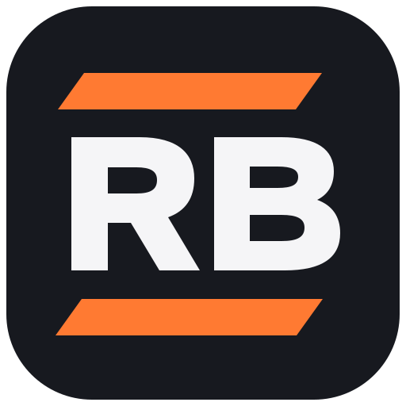

# RB Videofire 3.0.0

Editor de vídeo local para Windows 10/11 x64, reconstruído sobre o motor Rust do Concat.



A interface usa a identidade RB Videofire: grafite, laranja, símbolo RB e português brasileiro por padrão. O executável é `RBVideofire.exe`. Configurações e modelos ficam em um namespace próprio, sem mover instalações Concat.

## Usar e compilar

Os instaladores e o ZIP portátil são produzidos pelo workflow **RB Videofire Windows**, após compilação e testes de inicialização. Enquanto o workflow não concluir, este repositório contém código-fonte, não um executável Windows validado.

Para compilar no computador, consulte [BUILD_RB_WINDOWS.md](docs/BUILD_RB_WINDOWS.md) e execute `compilar.bat`. Para abrir um pacote já compilado, use `iniciar.bat`.

[Guia de primeira edição](docs/GUIA_RB_VIDEOFIRE.md) · [Origem e créditos](NOTICE_RB_VIDEOFIRE.md) · [Licença](LICENSE)

## Recursos da base

O código inclui timeline multifaixa, cortes, títulos, keyframes, efeitos, áudio, proxies, composição por GPU e exportação com FFmpeg. Também contém integração com modelos locais de legendagem, voz e recorte de fundo. Esses modelos são opcionais e exigem download inicial.

A presença de um módulo no código não comprova seu funcionamento neste fork. A validação de reprodução, exportação, GPU e modelos no Windows depende dos testes do pacote e do equipamento.

## Projetos

Novos projetos usam uma pasta contendo `project.rbvf`, mídia e arquivos auxiliares. Abra a pasta pelo programa. Pastas legadas contendo `concat.json` ou `wolfcut.json` são reconhecidas e mantêm o nome original do manifesto.

Projetos das antigas versões C++ do RB Videofire ainda não têm migração validada. Compartilhar a extensão `.rbvf` não significa compartilhar o mesmo formato.

## Verificação

```sh
cargo test --manifest-path src/Cargo.toml -p concat-core -p concat-project --locked
cargo test --manifest-path tools/rb-platform-tests/Cargo.toml --locked
python scripts/locales.py --check
```

A suíte completa e o pacote Windows são verificados pelo GitHub Actions. O build usa Rust 1.93.1 e bibliotecas fixadas por SHA-256.

## Licença

AGPL-3.0-or-later. Distribuições modificadas devem preservar os avisos e disponibilizar o código-fonte correspondente conforme a licença. Leia também THIRD_PARTY_NOTICES.md.
